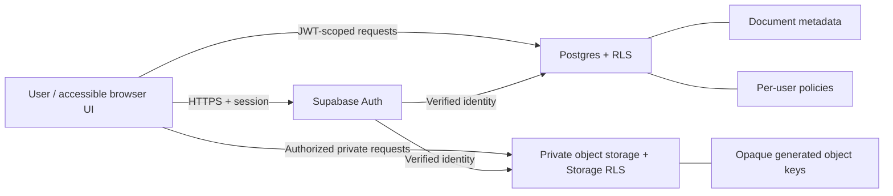

# Kaagaz Vault — Phase 2 Architecture & Data-Flow Specification

**Status:** Phase 2 design package complete. Phase 3 implementation is gated on owner approval of the product assumptions below.
**Scope:** architecture and data flow only. This document does not claim production storage, authentication, encryption, or authorization is implemented.

## 1. Repository baseline
The original `main` branch contained only a minimal README, with no application framework, backend, schema, or test setup. Phase 1 added a dependency-free HTML/CSS/JavaScript prototype and automated UI checks. Do not retrofit a backend into the static page without agreeing on the runtime and migration path.

## 2. Recommended architecture

### MVP working assumptions
These are planning defaults, not user-approved product requirements:
1. **Product model:** multi-user service with one private personal vault per account; no shared workspaces or public links in MVP.
2. **Runtime:** React + TypeScript + Vite for the production frontend, introduced after the UI prototype is accepted.
3. **Identity:** managed Supabase Auth, email verification and recovery, secure sign-out, rate limiting, and MFA available where appropriate.
4. **Metadata:** PostgreSQL, with owner-scoped rows and restrictive grants plus row-level security (RLS).
5. **Binary objects:** private Supabase Storage bucket; generated object keys; short-lived access only after authorization.
6. **Cryptography:** TLS in transit and provider-managed encryption at rest for the initial MVP. The service can technically access plaintext during authorized processing. **Do not claim end-to-end encryption, zero knowledge, or administrator-proof confidentiality.** If the product must be unable to decrypt files, stop and design client-side encryption and recovery before implementation.
7. **Sharing:** disabled in MVP.
8. **Initial file support:** PDF, JPEG, PNG and plain text are proposed allowlist items; formats, maximum size and quota require approval.
9. **Deployment and spend:** use a development project first; verify current provider quotas, region/data residency, backup coverage and cost before production. Do not promise permanently free production hosting.

### Logical architecture

The frontend may use a publishable client key only. Service-role keys, database passwords, signing secrets and provider admin credentials remain server-side and out of source control and built assets. RLS is not a replacement for correct SQL grants; both must be reviewed.

## 3. Data model

### `documents` (metadata only)
| Field | Type / rule | Purpose |
|---|---|---|
| `id` | UUID primary key, generated server-side | Stable internal identifier |
| `owner_id` | UUID, references authenticated user; NOT NULL | Authorization boundary |
| `display_name` | Bounded text, escaped on display | Human-readable label; never an object path |
| `category` | Controlled enum or validated text | UI grouping |
| `object_key` | Opaque generated key, unique | Private storage locator |
| `media_type` | Server-detected value | Display and safe handling |
| `size_bytes` | Positive integer, server-enforced maximum | Quota and display |
| `sha256` | Optional content hash | Integrity diagnostics; avoid public exposure |
| `created_at`, `updated_at` | UTC timestamps | Sorting and audit context |
| `is_favorite` | Boolean default false | User preference |
| `deleted_at` | Nullable timestamp if soft delete is selected | Recovery and purge lifecycle |

Recommended indexes: `(owner_id, updated_at DESC)`, `(owner_id, category)`, plus unique `object_key`. Avoid file contents and unnecessary sensitive personal data in metadata. Never log filenames, document contents, tokens or signed URLs.

Other records, if needed: minimal profiles; upload jobs with status/retry timestamps; redacted security events; and quota accounting reconciled against storage. Do not duplicate auth credentials in profiles.

## 4. Data-flow contracts

### A. Sign-in
1. User authenticates through managed Auth over TLS.
2. Auth issues a session token; the SDK attaches it to requests.
3. Database and Storage policies derive identity from the verified auth context.
4. Sign-out clears local session state; expiry/revocation behavior is tested. Never place tokens in URL parameters.

### B. Upload
1. Require an authenticated session and enforce account quota.
2. Validate allowlisted extension, actual content/signature, size and parser-specific constraints server-side. Do not trust the browser MIME type.
3. Generate a random/opaque storage key; never use the raw filename as an object key.
4. Upload to a private bucket with owner-scoped Storage policies.
5. Insert metadata using authenticated owner identity; constraints and RLS prevent owner spoofing.
6. If metadata insertion fails after upload, perform compensating cleanup/retry and record a redacted operational event.
7. Do not show “saved” until object and metadata state are reconciled.

### C. List / preview / download
1. Query metadata; RLS returns only the caller's rows.
2. Authorize the metadata row and object key as one logical resource.
3. Use authenticated private Storage requests or issue a very short-lived signed URL after authorization.
4. Treat signed URLs as bearer secrets: never log, persist unnecessarily, or send to analytics. They remain usable until expiry.
5. Use safe content-disposition and content-type handling; never render untrusted HTML/SVG inline.

### D. Rename / favorite / delete
- Rename updates display metadata only; the storage key remains opaque.
- Favourite updates only the caller's record.
- Delete requires an explicit retention rule. Coordinate object and metadata deletion with retries and reconciliation; define whether deletion is soft or hard.
- Avoid orphaned objects and metadata that promises a missing object.

### E. Export and account deletion
Define export packaging, short-lived delivery and cleanup. Account deletion must specify disabling access, deleting metadata and objects, handling backups, and reporting completion. Backup retention can delay physical erasure; communicate that honestly.

## 5. Threat model

| Threat | Primary controls | Verification required |
|---|---|---|
| Cross-account access / IDOR | Owner-scoped RLS, Storage policies, least-privilege grants | Two-user allow/deny tests for CRUD and object operations |
| Public or leaked URL | Private bucket, short-lived signed URLs, no URL logging | Anonymous download denied; expiry verified |
| Malicious upload | Server-side content validation, allowlist, limits, generated keys, optional scanning/CDR | MIME spoofing, double extensions, oversize and malformed files rejected |
| Secret leakage | No privileged keys in frontend/repo; secret scanning | Scan source, build output and history |
| Account takeover | Managed auth, TLS, recovery protections, rate limits, MFA option | Expiry, recovery, sign-out and abuse tests |
| Stored XSS in metadata | Contextual escaping, no unsafe HTML injection, safe disposition | Payloads in names/categories display as text |
| Data loss / partial writes | Reconciliation jobs, DB + object backups, restore drills | Restore metadata and binary fixtures together |
| Privacy leakage in logs | Redacted events, retention and least privilege | Review logs with sensitive test fixtures |
| Quota exhaustion | Per-user quotas and server-side limits | Concurrent uploads and quota-race tests |

This is a design-level threat model, not a completed penetration test.

## 6. Privacy and cryptography decision gate
**Proposed MVP baseline:** TLS + managed at-rest encryption + strict authorization. This does not prevent the service or a compromised privileged backend from accessing plaintext.

If end-to-end encryption is required, separately design client-side encryption, key derivation/rotation, multi-device recovery, lost-password consequences, sharing, search/indexing, previews, metadata leakage and backups. Do not improvise a crypto helper and call the vault zero-knowledge.

## 7. Operations and recovery
- Database backups and object-storage recovery are separate. A database backup may contain only object metadata and may not restore deleted binary files.
- Define RPO and RTO with the product owner.
- Test a full restore in a separate environment; verify file counts, references and authorized retrieval.
- Track provider plan/region, retention and quotas as deployment configuration, not assumptions in code.
- Exclude document contents from logs, telemetry, crash reports and support exports.
- Maintain dependency updates, security advisories, secret scanning and an incident response process.

## 8. Architecture decision records
| ID | Decision | Status | Revisit if |
|---|---|---|---|
| ADR-001 | React + TypeScript + Vite | Recommended | Current UI is rejected or SSR is required |
| ADR-002 | Supabase Auth + PostgreSQL RLS + private Storage | Recommended | Region, policy, cost or compliance does not fit |
| ADR-003 | One private vault per account; no sharing in MVP | Planning default | Shared workspaces are core |
| ADR-004 | Managed encryption baseline; no E2EE claim | Planning default; approval needed | Service must be unable to decrypt |
| ADR-005 | PDF/JPEG/PNG/plain-text allowlist | Proposed; approval needed | Format requirements differ |
| ADR-006 | No public object URLs; access only after authorization | Required invariant | No planned exception for sensitive docs |
| ADR-007 | Recovery includes binary objects, not only database | Required invariant | Do not waive without explicit risk acceptance |

## 9. Phase 3 acceptance gates
- Reproducible migrations and tested schema constraints.
- RLS grants/policies have allow-and-deny tests for two users and signed-out clients.
- Private bucket and object ownership/CRUD policies are tested.
- Server-side upload checks, quotas, generated keys and safe headers are implemented.
- Auth recovery, expiry, sign-out, account deletion and export are tested.
- Frontend build contains no service-role/secret keys.
- Database and binary objects can be restored and reconciled.
- Owner approves user model, encryption mode, formats, region, budget and retention.

## 10. Official references
- Supabase RLS: https://supabase.com/docs/guides/database/postgres/row-level-security
- Supabase secure data: https://supabase.com/docs/guides/database/secure-data
- Supabase Storage access control: https://supabase.com/docs/guides/storage/security/access-control
- Private/public buckets: https://supabase.com/docs/guides/storage/buckets/fundamentals
- Supabase Auth: https://supabase.com/docs/guides/auth
- Supabase database backups: https://supabase.com/docs/guides/platform/backups
- OWASP File Upload Cheat Sheet: https://cheatsheetseries.owasp.org/cheatsheets/File_Upload_Cheat_Sheet.html
- OWASP ASVS: https://owasp.org/projects/asvs
- W3C guidance for older users: https://www.w3.org/WAI/older-users/
