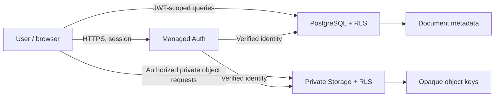

# Phase 2 — Architecture and Data-Flow Report

**Status: Design package complete (100%). Overall project: 33%** using an equal-weight average of six phases.

## Executive decision
Recommend React + TypeScript + Vite for the production frontend, Supabase Auth for identity, PostgreSQL with explicit grants and row-level security for metadata, and a private Supabase Storage bucket for document objects. This reduces infrastructure overhead; it does not make the application automatically secure.

## Proposed system

## Planning assumptions
- Multi-user service; one isolated personal vault per account.
- No public sharing or shared workspace in MVP.
- Proposed allowlist: PDF, JPEG, PNG and plain text.
- TLS and managed encryption at rest for the initial baseline; service can technically access plaintext during authorized processing. No E2EE/zero-knowledge claim.
- Owner must approve these defaults before implementation.

## Controls

| Area | Design requirement |
|---|---|
| Identity | Managed auth, email verification/recovery, session expiry, secure sign-out |
| Authorization | Explicit database grants + RLS; per-user object policies; allow/deny tests |
| Upload | Server-side size/content validation, allowlist, opaque keys, quotas, cleanup |
| Download | Private bucket, authorization before access, short-lived signed URLs if needed |
| Secrets | Publishable client key only; privileged keys server-side |
| Deletion | Defined retention, object/metadata reconciliation, account deletion workflow |
| Recovery | Back up database and binary objects; rehearse full restore |
| Privacy | Redact logs; no contents, tokens or signed URLs in analytics |

## Threats covered
Cross-account access, leaked URLs, malicious uploads, session compromise, stored XSS via metadata, secrets in bundles, partial writes/orphaned files, quota abuse, privacy leakage and data loss. Detailed controls and verification criteria are in [ARCHITECTURE.md](ARCHITECTURE.md).

## Decisions requiring owner approval
1. Private personal vaults only or shared family/team workspaces?
2. Is managed encryption sufficient, or must the service be unable to decrypt files (E2EE)?
3. Required formats, maximum size and per-user quota?
4. Deployment region, data-residency requirements, budget and vendor lock-in tolerance?
5. Retention and permanent-deletion expectations?

These are explicit Phase 3 gates, not silent assumptions.

## Next phase
Implement migrations, managed auth, owner-scoped RLS policies, private bucket policies and server-validated upload lifecycle in a development project. Add two-user authorization tests and restore tests before onboarding real documents.

## Research sources
- [Supabase RLS](https://supabase.com/docs/guides/database/postgres/row-level-security)
- [Supabase secure data](https://supabase.com/docs/guides/database/secure-data)
- [Supabase Storage access control](https://supabase.com/docs/guides/storage/security/access-control)
- [Private and public buckets](https://supabase.com/docs/guides/storage/buckets/fundamentals)
- [Supabase Auth](https://supabase.com/docs/guides/auth)
- [Supabase database backups](https://supabase.com/docs/guides/platform/backups)
- [OWASP File Upload Cheat Sheet](https://cheatsheetseries.owasp.org/cheatsheets/File_Upload_Cheat_Sheet.html)
- [OWASP ASVS](https://owasp.org/projects/asvs)
- [W3C Older Users and Web Accessibility](https://www.w3.org/WAI/older-users/)
