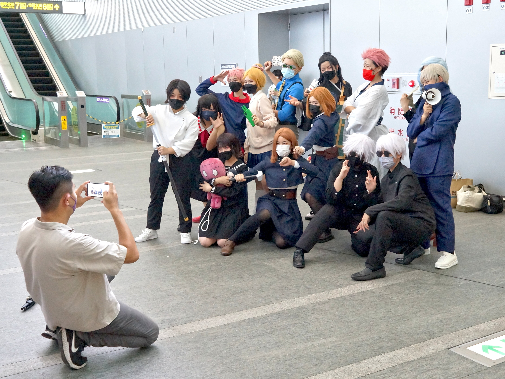

<div align="center">


# KAAGAZ VAULT / OVERVIEW

### Private papers. Sharp focus. Zero cloud hand-off.

</div>

<p align="center">
  
</p>

<div align="center">

[Back to README](../README.md) · [Document import notes](engineering/document-import.md) · [Quality gates](engineering/quality-gates.md) · [Visual attribution](images/ATTRIBUTION.md)

</div>

---

## The product in one sentence

Kaagaz Vault is an offline-first Android document vault that helps people capture, search, review, and organize important papers while keeping the FOSS document pipeline on the device.

The Gojo imagery is deliberate visual language: controlled power, strong boundaries, and a high-energy surface around a product whose actual promise is restraint. The images are sourced from Wikimedia Commons under CC BY-SA 4.0, not scraped promotional art.

## The loop

```text
    CAPTURE                  REVIEW                    RETURN
 PDF · image · camera   →   local OCR · edit   →   encrypted shelf
        ↑                         ↓                      ↓
        └──────────── search · reminders · safe transfer ────────┘
```

### Capture

Choose a PDF or image through Android’s document picker, or capture a page with CameraX. The import path is bounded and designed for app-private storage without broad storage permission.

### Review

Offline Tesseract OCR supports English, Hindi, and Telugu. Extracted text is evidence, not authority. The user can correct it and see that review state explicitly.

### Return

Encrypted payloads and metadata stay local. The interface is designed around the next useful action instead of a feed, ad slot, or notification pressure loop.

## Why the visual system is loud

The public repository page should be instantly recognizable. The Android interface itself can remain calm and accessible while the README uses deep blue, cyan light, vivid purple, and high-contrast Gojo photography to communicate the project’s identity at a glance.

- **Hero:** 5,947 × 3,813 CC BY-SA banner with a Gojo-themed vehicle at Comic Con Chile.
- **Template:** CC BY-SA Gojo cosplay portrait for the repository identity lockup.
- **Source frame:** 4,352 × 3,264 CC BY-SA group photograph from the same cosplay source.
- **Typography:** Short headlines, hard contrast, and generous breathing room.
- **Trust cue:** Every external visual is documented with author, source URL, dimensions, and license.

<p align="center">
  
</p>

## What the source branch contains

The active implementation branch contains the Compose shell, encrypted local document paths, Android Keystore and AES-GCM protection, bounded import, CameraX capture, offline OCR, SQLCipher-backed metadata search, reminders, reduced-motion behavior, accessibility-aware simplified mode, privacy-safe app switching, and the allowlisted local settings-transfer flow.

The project is still in verification. Biometric/auth-bound vault locking, recovery evidence, rotation evidence, device leakage checks, secure-deletion expectations, and final release gates remain explicit engineering work. The landing page is intentionally confident about the visual identity and conservative about security claims.

## Attribution and rights

The photographs are open-licensed works, but the CC license applies to the photographs and adaptations, not to the underlying *Jujutsu Kaisen* characters, logos, or franchise rights. This project is not official and does not claim affiliation.

- Banner author: [Rjcastillo](https://commons.wikimedia.org/wiki/User:Rjcastillo)
- Portrait/source author: [Solomon203](https://commons.wikimedia.org/wiki/User:Solomon203)
- License: [Creative Commons Attribution-ShareAlike 4.0 International](https://creativecommons.org/licenses/by-sa/4.0/)
- Full file-level record: [images/ATTRIBUTION.md](images/ATTRIBUTION.md)

<div align="center">

**Visual refresh by Tommy.**

</div>
