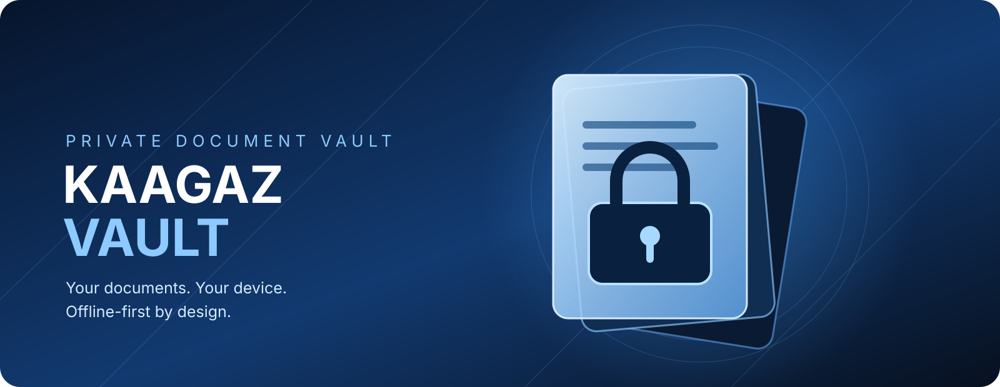

<div align="center">



# KAAGAZ VAULT / OVERVIEW

### Private papers. Sharp focus. Zero cloud hand-off.

</div>

<p align="center">
  
</p>

<div align="center">

[Back to README](../README.md) · [Document import notes](engineering/document-import.md) · [Quality gates](engineering/quality-gates.md)

</div>

---

## The product in one sentence

Kaagaz Vault is an offline-first Android document vault that helps people capture, search, review, and organize important papers while keeping the FOSS document pipeline on the device.

The visual identity uses a focused, high-contrast document-vault theme around a product whose actual promise is restraint.

## The loop

```text
    CAPTURE                  REVIEW                    RETURN
 PDF · image · camera   →   local OCR · edit   →   encrypted shelf
        ↑                         ↓                      ↓
        └──────────── search · reminders · safe transfer ────────┘
```

### Capture

Choose a PDF or image through Android’s document picker, or capture a page with CameraX. The import path is bounded and designed for app-private storage without broad storage permission.

### Review

Offline Tesseract OCR supports English, Hindi, and Telugu. Extracted text is evidence, not authority. The user can correct it and see that review state explicitly.

### Return

Encrypted payloads and metadata stay local. The interface is designed around the next useful action instead of a feed, ad slot, or notification pressure loop.

## Visual system

The repository presentation uses deep blue, cool highlights, clear typography, and generous spacing. The Android interface itself can remain calm and accessible while the project identity stays recognizable at a glance.

## What the source branch contains

The active implementation branch contains the Compose shell, encrypted local document paths, Android Keystore and AES-GCM protection, bounded import, CameraX capture, offline OCR, SQLCipher-backed metadata search, reminders, reduced-motion behavior, accessibility-aware simplified mode, privacy-safe app switching, and the allowlisted local settings-transfer flow.

The project is still in verification. Biometric/auth-bound vault locking, recovery evidence, rotation evidence, device leakage checks, secure-deletion expectations, and final release gates remain explicit engineering work. The landing page is intentionally confident about the visual identity and conservative about security claims.

