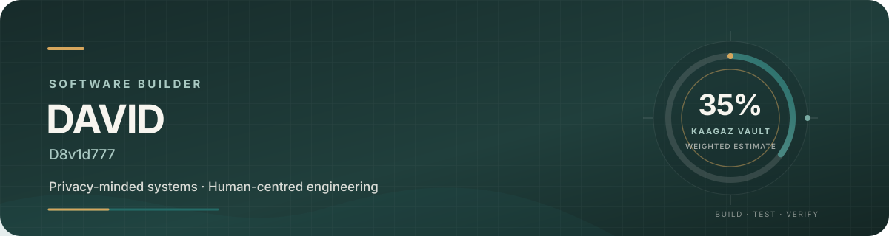

# David · D8v1d777

### Software builder · Privacy-minded systems · Human-centred engineering

*I build practical software with deliberate design, local-first thinking, and security claims tied to evidence.*

---

## ✦ What guides my work

<table>
<tr>
<td width="50%" valign="top">

### 🔐 Privacy by default

Keep sensitive data local where possible, minimize unnecessary permissions, and treat key loss, migration, and recovery as first-class engineering problems.

</td>
<td width="50%" valign="top">

### 🧭 Human-centred UX

Reduce cognitive load, explain consequential actions plainly, and design for different levels of technical confidence and visual ability.

</td>
</tr>
<tr>
<td width="50%" valign="top">

### 🧪 Evidence over claims

Separate authored code from passing tests, device verification, and independent review. Encryption alone is not proof that an application is secure.

</td>
<td width="50%" valign="top">

### 🛠️ Deliberate execution

Research the problem, implement a narrow slice, test it, review the evidence, then document the outcome and limitations.

</td>
</tr>
</table>

## ◈ Featured build

### [KAAGAZ VAULT](https://github.com/D8v1d777/KAAGAZ-VAULT)

An offline-first Android document-vault project exploring encrypted local storage, offline OCR, private search, accessible document workflows, and an authentication-bound vault-lock architecture.

| Product progress | Workstream | Evidence status |
|:--:|:--|:--|
| **35%** | Overall weighted product estimate | End-to-end acceptance gates still open |
| **100% authored** | Migration-state model and durable journal foundations | CI / integration verification pending |
| **100% authored** | Auth-bound key and wrapped-key persistence foundations | Device verification and integration pending |
| **0%** | Production migration coordinator | Not implemented |
| **0%** | Repository/session enforcement | Not implemented |
| **0%** | Physical-device and crash/power-loss verification | Not performed |

Progress ratios are scope estimates, not security scores. “Authored” does not mean tested, integrated, or production-ready. See the [Phase 12 engineering report](https://github.com/D8v1d777/KAAGAZ-VAULT/blob/docs/auth-bound-migration-design/docs/reports/PHASE-12-AUTH-BOUND-VAULT-LOCK-REPORT.md) for the detailed gates.

## ⌁ How I build

**Research** → **Threat model** → **Small implementation** → **Tests** → **Review evidence** → **Clear documentation**

- Prefer small, reviewable changes over giant rewrites.
- Keep sensitive data out of logs, fixtures, and unnecessary network paths.
- Treat accessibility as a product requirement, not a finishing touch.
- Keep documentation and implementation changes reviewable on separate branches.
- Use visual polish to improve clarity—not to disguise unfinished behavior.

## ↗ Explore

- **Projects:** [KAAGAZ VAULT](https://github.com/D8v1d777/KAAGAZ-VAULT) · [RAVEN](https://github.com/D8v1d777/RAVEN) · [Novellesee](https://github.com/D8v1d777/Novellesee)
- **GitHub:** [@D8v1d777](https://github.com/D8v1d777)

---

Designed for clarity · Built with care · Verified before claimed

---

### Design and publishing notes

- **Palette:** deep ink `#172B2A`, evergreen teal `#246B67`, warm paper `#F7F5EF`, and muted amber `#D6A65D`.
- **Hierarchy:** custom SVG hero, concise identity statement, paired value cards, a compact evidence-led progress table, and direct project links.
- **Accessibility:** text labels accompany color, no flashing animation, no visitor counter, and no third-party analytics widgets.
- **Progress integrity:** the 35% figure is the existing weighted product estimate. The task-level ratios above retain their previous scores and explicitly distinguish authored work from verified completion.
- **Publishing status:** this remains a draft, not the live account profile. The GitHub profile README repository `D8v1d777/D8v1d777` does not exist in the accessible repository list, and the available GitHub actions do not expose repository creation or direct profile editing. Publish by placing this file at the root of a repository named exactly `D8v1d777`, with the banner at `assets/profile-hero.svg`.
