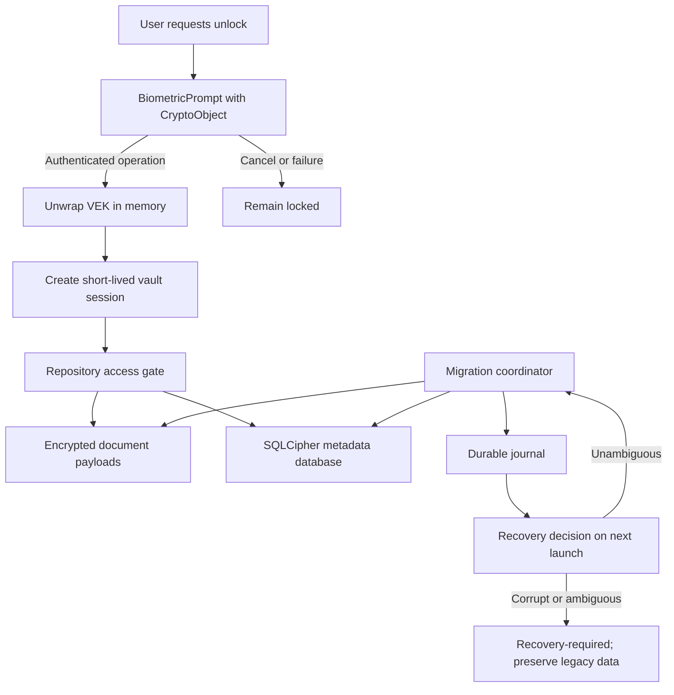

# KAAGAZ VAULT
### Phase 12 · Authentication-Bound Vault Lock

**Engineering decision report · 18 October 2026**

*Private by design. Calm under pressure. Honest about what is—and is not—verified.*

---

## 01 — Executive readout

> [!IMPORTANT]
> The migration-state policy model and the durable journal are **foundations, not a production lock**. Do not claim authentication-bound encryption, end-to-end encryption, crash-safe migration, secure deletion, or release readiness until the full implementation and acceptance gates pass.

The current app encrypts document payloads with an Android Keystore key and separately wraps the SQLCipher database key. The existing payload key is non-exportable, so it cannot simply be exported and rewrapped as a new Vault Encryption Key (VEK). Existing payloads need a decrypt–re-encrypt migration, with database and SQLite sidecar lifecycle coordinated around it.

### Progress snapshot

| Workstream | Current evidence | Progress for this slice |
|---|---|---:|
| Threat model and migration ADR | Draft decision record and implementation plan | 100% drafted |
| Migration state policy | Immutable state model + JVM test source | 100% authored |
| Durable journal | Versioned bounded snapshot + recovery logic + expanded test source on code PR | 100% authored; CI pending |
| Auth-per-use wrapping + wrapped-key persistence | Kotlin source and JVM persistence tests authored; not integrated or device-tested | 100% authored; verification pending |
| Production migration runner | Not implemented | 0% |
| Repository/session gate | Not implemented | 0% |
| Physical-device and crash/power-loss verification | Not performed | 0% |

**Product completion:** keep the existing weighted estimate at **35%** until end-to-end acceptance gates pass. These are scope-progress ratios, not security scores.

---

## 02 — Target architecture

**Non-negotiable rule:** the UI must not be the security boundary. The repository/data access path must reject reads and writes without a valid unlocked session. A biometric dialog that merely hides a screen is cosmetic and insufficient.

---

## 03 — Migration transaction

1. **Inventory** opaque document IDs and confirm legacy key/database availability.
2. **Prepare** the new VEK and its auth-bound wrapping key; persist only wrapped key material.
3. **Stage** each re-encrypted document to a ciphertext-only temporary file.
4. **Verify** the staged ciphertext by decrypting it and checking authenticated document-ID context.
5. **Publish** the new ciphertext atomically while retaining a recoverable legacy copy.
6. **Rewrap** the SQLCipher key only after all document publications are recorded.
7. **Verify** database integrity and reopen behavior.
8. **Complete** the journal only after every verification gate passes.
9. **Retire legacy data** only after durable completion and a separately reviewed recovery policy.

If a key, journal, ciphertext, document identifier, or integrity check is missing or ambiguous, pause migration and preserve recoverable material. Never silently generate a replacement key for an existing vault.

---

## 04 — Journal design and limits

The journal snapshot is bounded and versioned. It stores migration phase, opaque canonical document UUIDs, per-document progress, database-key migration flags, and recovery phase. It does **not** store keys, document names, OCR text, plaintext, or document ciphertext. The code PR also adds an auth-per-use Android Keystore AES-GCM primitive that wraps a random 256-bit VEK, plus create-once wrapped-key persistence; the same cipher instance must be passed through `BiometricPrompt.CryptoObject`. These are source-level foundations, not a complete or integrated lock.

- File contents are synced before publication.
- The separate wrapped-VEK store is create-once and refuses replacement; it stores only the IV + authenticated ciphertext/tag envelope.
- A backup is retained while replacing the primary snapshot.
- Recovery prefers a valid primary, then a valid backup; ambiguous corruption fails closed.
- A pending file is accepted only when it represents an interrupted first write.
- CRC32 is an accidental-corruption check, **not** cryptographic authenticity against a local attacker.
- Portable JVM APIs do not guarantee directory metadata fsync across all supported devices/filesystems.
- The journal is not yet connected to a production migration coordinator; side effects still need idempotency and device-level crash testing.

---

## 05 — Product design system: calm, legible, trustworthy

These are **design targets for the application UI**, not a claim that a complete screen redesign has already shipped.

### Palette scorecard

| Token | Hex | Intended use | Contrast / accessibility note |
|---|---|---|---|
| Ink | `#172B2A` | Primary text, deep navigation | Use on warm light surfaces |
| Paper | `#F7F5EF` | Main background | Reduces harsh pure-white glare |
| Teal | `#246B67` | Primary actions, selected states | Reserve for interactive emphasis |
| Sage | `#DDE9DF` | Quiet supporting panels | Never use alone to signal status |
| Amber | `#9B5C13` | Caution / recovery attention | Pair with explicit text and icon |
| Rose | `#A43D46` | Destructive action / failure | Pair with labels; never color-only |
| Slate | `#52615F` | Secondary text | Validate contrast per final surface |

**Palette target: 10/10** for coherence and product fit; **contrast score: pending** until every foreground/background pair is checked against WCAG 2.2 AA and tested in light/dark themes. A visually pleasing palette is not automatically accessible.

### Type and hierarchy

- **Display / page titles:** a restrained humanist sans-serif, medium weight; short titles, no all-caps paragraphs.
- **Body:** Android system sans-serif for predictable rendering and familiar platform behavior.
- **Metadata / IDs:** system monospace only for technical identifiers, never for long reading.
- **Body size:** start at 16sp; support system font scaling through at least 200% without clipping or horizontal scrolling.
- **Line length:** target 45–75 characters in long-form explanatory panels.
- **Spacing:** 4dp base rhythm; 8/12/16/24/32dp semantic steps.
- **Touch targets:** at least 48dp, with clear focus/pressed/disabled states.
- **Status:** icon + text + color; never color alone.

### Interaction pattern

1. One dominant action per screen.
2. Destructive operations use plain-language consequences and a reversible step where feasible.
3. Security errors explain what the app preserved and the safest next step, without exposing secret material.
4. Unlock failure never looks like successful unlock.
5. Avoid shame, urgency theater, fake progress, or manipulative prompts around sensitive documents.
6. Offer readable recovery explanations before advanced technical details.

| Design dimension | Target | Honest status |
|---|---:|---|
| Palette coherence | 10/10 | Proposed tokens; contrast audit pending |
| Component consistency | 10/10 | Pattern specification drafted |
| Typography / readability | 10/10 | Type scale proposed; device validation pending |
| Accessibility | WCAG 2.2 AA target | Not audited end-to-end |
| Motion / feedback | Calm, purposeful | Not implemented as a full design system |

---

## 06 — Acceptance gates

- [ ] CI: debug + release builds, JVM tests, lint, merged-manifest/offline policy.
- [ ] Journal: valid round-trip, version rejection, malformed/truncated file, checksum mismatch, backup restore, interrupted first write, and size-bound tests.
- [ ] State machine: no skipped/reversed document steps; no premature DB-key migration or legacy retirement.
- [ ] Keystore: auth-per-use key on supported API levels; enrollment invalidation and cancellation behavior documented.
- [ ] CryptoObject: unwrap is possible only with a cipher authenticated by the prompt.
- [ ] Session: repository and background jobs are gated; process death and screen-off relock are tested.
- [ ] Migration: each crash point can resume or stop without losing the only valid copy.
- [ ] SQLCipher: close handles and manage WAL/journal sidecars before rewrap.
- [ ] Device: physical-device tests across biometric availability, device credential fallback, enrollment changes, lockout, reboot, and process death.
- [ ] Accessibility: large fonts, screen reader, focus order, high contrast, and reduced motion.
- [ ] Independent security review before any strong security claim.

---

## 07 — Branch and review policy

| Branch | Contents | Rule |
|---|---|---|
| `feat/durable-vault-migration-journal` | Kotlin implementation and JVM tests | No documentation-only commits |
| `docs/auth-bound-migration-design` | Architecture, research, design scorecard, progress report | Documentation changes stay here |
| `phase/11-auth-bound-vault-lock` | Existing implementation baseline | Do not merge unverified work directly |

Review and merge through pull requests. Keep the main branch free of in-progress documentation changes; this report is deliberately isolated on the documentation branch.

---

## 08 — References

- [Android biometric authentication](https://developer.android.com/identity/sign-in/biometric-auth)
- [BiometricPrompt.CryptoObject](https://developer.android.com/reference/kotlin/android/hardware/biometrics/BiometricPrompt.CryptoObject)
- [OWASP Key Management Cheat Sheet](https://cheatsheetseries.owasp.org/cheatsheets/Key_Management_Cheat_Sheet.html)
- [OWASP Cryptographic Storage Cheat Sheet](https://cheatsheetseries.owasp.org/cheatsheets/Cryptographic_Storage_Cheat_Sheet.html)

*Build carefully. Verify explicitly. Claim only what the evidence supports.*

